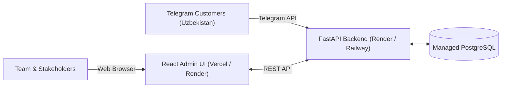

# NEXUS AI — 24/7 Cloud Deployment Guide

This guide explains how to deploy **NEXUS AI** (FastAPI Backend, React Admin Dashboard, and PostgreSQL) to free/starter 24/7 cloud hosting so that anyone in the world can access it via public `https://` URLs.

---

## Architecture in the Cloud



---

## Step 1: Push Code to GitHub

All cloud hosting providers (Render, Railway, Vercel) deploy automatically from your GitHub repository.

1. Open a terminal in the project root:
   ```powershell
   cd "d:\antigravity projects\ai agent"
   ```
2. Commit the codebase:
   ```powershell
   git add .
   git commit -m "feat: complete NEXUS AI production platform"
   ```
3. Create a new repository on [GitHub](https://github.com/new) (e.g. `nexus-ai`) and push:
   ```powershell
   git remote add origin https://github.com/<your-username>/nexus-ai.git
   git branch -M main
   git push -u origin main
   ```

---

## Step 2: Deploy to Cloud (Choose Option A or Option B)

### Option A: Render (Recommended — 100% Automated Blueprint)

Render uses the included `render.yaml` Blueprint file to automatically create the **PostgreSQL Database**, **FastAPI Backend**, and **React Frontend Static Site** in one click.

1. Go to [Render Dashboard](https://dashboard.render.com/) and sign up (Free).
2. Click **New +** &rarr; **Blueprint**.
3. Connect your GitHub account and select your `nexus-ai` repository.
4. Render will read `render.yaml` and display:
   - **`nexus-ai-db`**: PostgreSQL 16 database.
   - **`nexus-ai-backend`**: FastAPI Web Service (`https://nexus-ai-backend.onrender.com`).
   - **`nexus-ai-admin`**: React Static Site (`https://nexus-ai-admin.onrender.com`).
5. Click **Apply**.
6. When deployment finishes, open your static site URL: you will see the live NEXUS AI Admin Dashboard!

---

### Option B: Railway (Fastest Full-Stack Container)

Railway runs Docker containers and provides continuous background execution for the Telegram Bot.

1. Go to [Railway.app](https://railway.app/) and sign up with GitHub.
2. Click **New Project** &rarr; **Deploy from GitHub repo** &rarr; select `nexus-ai`.
3. Add a Database:
   - In your Railway project canvas, click **+ New** &rarr; **Database** &rarr; **Add PostgreSQL**.
4. Configure Backend Environment Variables:
   - In the service settings, add:
     - `DATABASE_URL`: `${{Postgres.DATABASE_URL}}`
     - `APP_ENV`: `production`
     - `TELEGRAM_BOT_TOKEN`: *Your BotFather Token*
     - `GEMINI_API_KEY`: *Your Google Gen AI Key* (optional, mock mode works if omitted)
     - `AI_MOCK_MODE`: `false` (or `true` for offline mode)
5. Generate Public Domain:
   - Under **Settings** &rarr; **Networking**, click **Generate Domain**. You will receive an instant `https://nexus-ai-production.up.railway.app` URL.

---

### Option C: Frontend on Vercel + Backend on Render/Railway

If you want the dashboard on Vercel's global CDN:

1. Go to [Vercel](https://vercel.com/) and click **Add New** &rarr; **Project**.
2. Import your GitHub repo.
3. In **Root Directory**, click edit and select `frontend`.
4. In **Environment Variables**, add:
   - `VITE_API_URL`: `https://nexus-ai-backend.onrender.com` (your backend URL)
5. Click **Deploy**. Vercel will give you a public `https://nexus-ai-admin.vercel.app` URL.

---

## Step 3: Connect Telegram Bot to Public Cloud

Once your backend is live with a public HTTPS URL:

1. **Webhook Mode (Instant delivery)**:
   Set `TELEGRAM_WEBHOOK_URL` in your backend environment variables:
   ```env
   TELEGRAM_WEBHOOK_URL=https://your-backend-url.onrender.com/api/telegram/webhook
   ```
2. **Or Long-Polling Mode**:
   If deployed as a background worker on Railway or Render, leave `TELEGRAM_WEBHOOK_URL` empty and run:
   ```bash
   python scripts/run_bot.py
   ```

---

## Summary of Public URLs to Share

| Service | Public URL Example | Purpose |
| :--- | :--- | :--- |
| **Admin Dashboard** | `https://nexus-ai-admin.onrender.com` | Share with managers, clients, or operators to view live conversations, manage products, and audit logs. |
| **Backend REST API** | `https://nexus-ai-backend.onrender.com` | Serves API requests, health checks (`/api/health`), and OpenAPI Swagger (`/docs`). |
| **Telegram Bot** | `https://t.me/YourBotHandle` | Customers in Uzbekistan chat in Uzbek, Russian, or English to search products, track orders, or request human help. |
