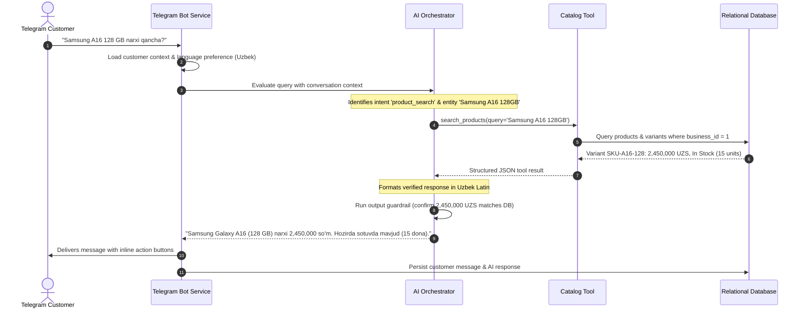
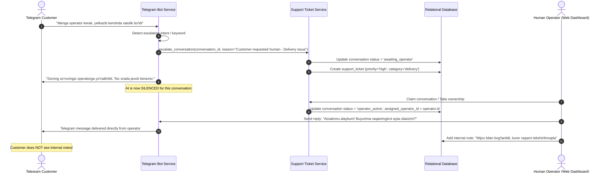

# NEXUS AI — System Architecture Document
## Architectural Patterns, Component Designs & Data Flows

**Version:** 1.0.0  
**Status:** Approved  
**Author:** Software Architecture & Engineering Team

---

## 1. High-Level Architectural Pattern

NEXUS AI follows a **Modular Monolith** architecture with clean domain separation, asynchronous I/O, dependency injection, and layered responsibilities. This design maximizes testability, simplifies local Windows development, avoids premature distributed system complexity (no microservice mesh, no Redis, no Celery), while remaining fully prepared for horizontal scaling.

```
+-----------------------------------------------------------------------------------------+
|                                    CLIENT LAYER                                         |
|  +------------------------------------+        +-------------------------------------+  |
|  |     Telegram Messenger Client      |        |     Web Browser (Admin & Operator)   |  |
|  |  (Uzbek Latin/Cyrillic, RU, EN)    |        |        React + Vite + Tailwind      |  |
|  +-----------------+------------------+        +------------------+------------------+  |
+--------------------|----------------------------------------------|---------------------+
                     | Long Polling / Webhook                       | REST API & WS
                     v                                              v
+-----------------------------------------------------------------------------------------+
|                                APPLICATION GATEWAY LAYER                                |
|  +------------------------------------+        +-------------------------------------+  |
|  |       Telegram Bot Gateway         |        |         FastAPI REST Router         |  |
|  |   python-telegram-bot (Async)      |        |   Pydantic v2 validation & JWT Auth |  |
|  +-----------------+------------------+        +------------------+------------------+  |
+--------------------|----------------------------------------------|---------------------+
                     |                                              |
                     +----------------------+-----------------------+
                                            |
                                            v
+-----------------------------------------------------------------------------------------+
|                                BUSINESS SERVICE LAYER                                   |
|  +-------------------------+  +-------------------------+  +--------------------------+ |
|  |     Catalog Service     |  |      Order Service      |  |     Ticket Service       | |
|  | (Products, Variants,    |  | (Status, Lookup with    |  | (Escalation, Assignment, | |
|  |  Stock in UZS)          |  |  Customer Verification) |  |  Status Workflow)        | |
|  +-------------------------+  +-------------------------+  +--------------------------+ |
|  +-------------------------+  +-------------------------+  +--------------------------+ |
|  |  Knowledge Base Service |  |  Customer & Session Svc |  |    Audit & Analytics Svc | |
|  | (Policies, FAQs, Hours, |  | (Multi-turn Context,    |  | (Metrics, Cost Tracking, | |
|  |  Multilingual Content)  |  |  Language Preference)   |  |  Security Action Logs)   | |
|  +-------------------------+  +-------------------------+  +--------------------------+ |
|                                           |                                             |
|                                           v                                             |
|  +-----------------------------------------------------------------------------------+  |
|  |                           AI ORCHESTRATION SUBSYSTEM                              |  |
|  |  +-------------------------+  +----------------------+  +----------------------+  |  |
|  |  |  Prompt Injection Guard |  |  Google Gen AI SDK   |  |  Offline Mock Engine |  |  |
|  |  |  (Input/Output Defense) |  | (Function Calling)   |  |  (Rule-based NLP)    |  |  |
|  |  +-------------------------+  +----------------------+  +----------------------+  |  |
|  |  +-----------------------------------------------------------------------------+  |  |
|  |  |            Deterministic Tool Dispatcher (Pydantic Typed Tools)             |  |  |
|  |  +-----------------------------------------------------------------------------+  |  |
|  |  +-----------------------------------------------------------------------------+  |  |
|  |  |          Hallucination Guardrail (Fact Verification & Reconciliation)       |  |  |
|  |  +-----------------------------------------------------------------------------+  |  |
|  +-----------------------------------------------------------------------------------+  |
+-----------------------------------------------------------------------------------------+
                                            |
                                            v
+-----------------------------------------------------------------------------------------+
|                                DATA ACCESS LAYER (DAL)                                  |
|  +-----------------------------------------------------------------------------------+  |
|  |                     Tenant-Scoped Repository Interfaces                           |  |
|  |   (Enforces business_id boundary automatically on every query and mutation)       |  |
|  +-----------------------------------------------------------------------------------+  |
|                                           |
|                                           v
|  +-----------------------------------------------------------------------------------+  |
|  |                        SQLAlchemy 2.0 Async Engine                                 |  |
|  |             SQLite (Development)  <===>  PostgreSQL (Production)                   |  |
|  +-----------------------------------------------------------------------------------+  |
+-----------------------------------------------------------------------------------------+
```

---

## 2. Component Deconstruction

### 2.1 Backend Core (`backend/app/core`)
- **`config.py`**: Reads `.env` via `pydantic-settings`. Validates `DATABASE_URL`, `TELEGRAM_BOT_TOKEN`, `GEMINI_API_KEY`, `APP_ENV`, `LOG_LEVEL`, `DEFAULT_BUSINESS_ID`.
- **`database.py`**: Async session factory (`async_sessionmaker`), engine pooling configuration, base declarative class. Supports `sqlite+aiosqlite:///` and `postgresql+asyncpg://`.
- **`security.py`**: Password hashing using `passlib[bcrypt]`, JWT token creation and verification (`python-jose`), and bearer token extractors.
- **`logging.py`**: Structured JSON / console logger that masks sensitive strings (`bot_token`, `api_key`, `password`).

### 2.2 Domain Models & Repositories (`backend/app/models`, `backend/app/repositories`)
- Implements SQLAlchemy 2.0 mapped columns with explicit foreign key constraints, composite indexes for multi-tenant querying (`business_id`, `created_at`), and cascading rules.
- Repositories encapsulate raw SQL/ORM queries and enforce `WHERE business_id = :business_id` uniformly to eliminate accidental cross-tenant data leaks.

### 2.3 AI Orchestration Subsystem (`backend/app/ai`)
- **Provider Interface (`AIEngineInterface`)**:
  - `generate_response(conversation_id, customer_id, messages, business_context) -> AIResponse`
- **Implementations**:
  1. `GeminiAIEngine`: Official `google.genai` SDK wrapper. Builds system instruction containing business policies and locale context, binds tool definitions, runs execution loop (max 5 tool turns), and verifies returned values.
  2. `MockAIEngine`: Zero-dependency, offline deterministic engine. Uses regex and keyword intent recognition (e.g. "qancha", "narx", "price", "skolko", "buyurtma", "operator") to dispatch the exact same tools and return verified responses.
- **Tools**:
  - `search_products(query: str, category_id: Optional[int], min_price: Optional[float], max_price: Optional[float])`
  - `get_product_details(product_id: int)`
  - `check_inventory(product_id: int, variant_id: Optional[int])`
  - `get_business_hours()`
  - `get_delivery_policy(region: Optional[str])`
  - `get_return_policy()`
  - `get_faq_answer(question: str)`
  - `get_order_status(order_id: int, verified_customer_context: dict)`
  - `create_support_ticket(customer_id: int, category: str, message: str)`
  - `request_human_handoff(conversation_id: int, reason: str)`

### 2.4 Telegram Bot Subsystem (`backend/app/bot`)
- Uses `python-telegram-bot` v21+ in async mode.
- State handling: Stores conversation state in database (`conversations` and `messages`), with customer language preference resolved through:
  `Explicit Stored Preference -> Interactive Selection -> Auto Detection -> Default (Uzbek Latin)`.
- Keyboards:
  - Persistent Main Menu Reply Keyboard.
  - Interactive Inline Keyboards for language switching, category browsing, variant selection, and ticket confirmation.
- Safe message sender with rate limiting and truncation (Telegram 4096 character limit).

### 2.5 Admin API & Dashboard (`backend/app/api`, `frontend/`)
- RESTful JSON endpoints protected by JWT and role decorators (`Owner`, `Admin`, `Operator`, `Viewer`).
- Web console built with React 18, Vite, TypeScript, and Tailwind CSS.
- Fast, accessible components with state management via React Context / React Query hooks.
- 3-column operator workspace:
  - Col 1: Live conversation queue with search, status filters (AI active vs awaiting operator vs closed), unread tags.
  - Col 2: Chat message stream, real-time message sending to customer Telegram chat, internal operator note toggle.
  - Col 3: Customer profile, language preference, associated orders, active support ticket, escalation reason, handoff release button.

---

## 3. Data Flow Sequences

### 3.1 Product Inquiry Flow (Natural Language)


### 3.2 Human Escalation Flow


---

## 4. Error Handling & Resilience Strategy

| Failure Scenario | Mitigation & Fallback Strategy |
|---|---|
| **Gemini API Timeout / 503 / Quota Exceeded** | Bounded retry (3 attempts with exponential backoff & jitter). If unrecovered, falls back to deterministic local FAQ/Catalog matching or returns: *"I'm temporarily experiencing high load. A human support representative has been alerted."* |
| **Telegram Polling Network Glitch** | Automatic reconnection loop with jitter. Handlers wrap updates in idempotent transaction boundaries to avoid processing duplicate update IDs. |
| **Database Disconnect** | SQLAlchemy pool pre-ping connection check. Failures trigger HTTP 503 on API and safe fallback on Bot with error alerts logged. |
| **Prompt Injection Attempt** | Sanitizer strips instruction delimiters and triggers a canned deflection response without sending untrusted payloads to Gemini. |
| **Missing Product Price / Incomplete Data** | The bot is forbidden from guessing prices. It explicitly responds: *"Current price is unavailable. Would you like to speak with a representative?"* |
